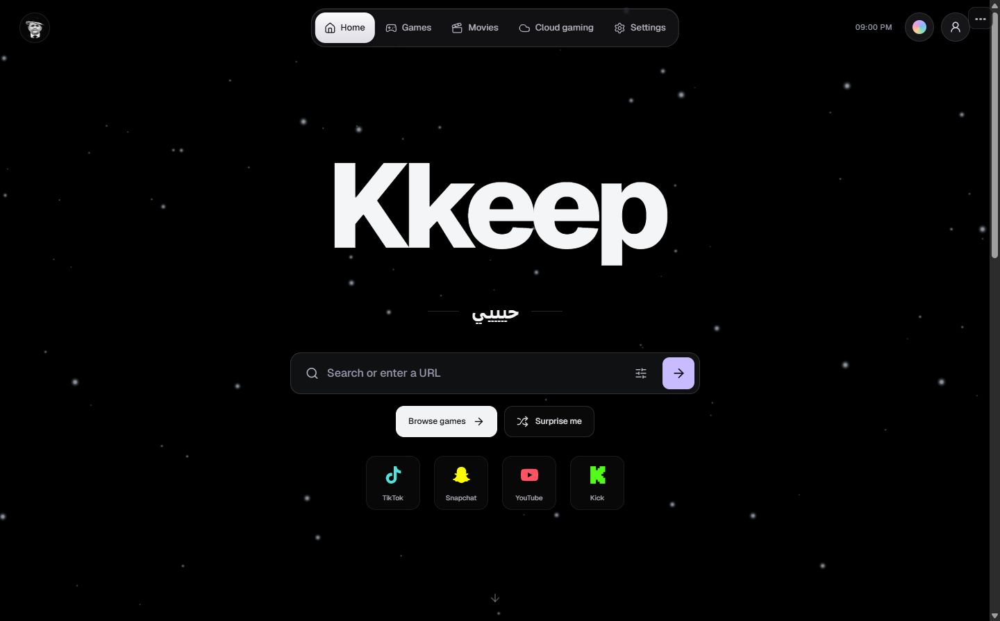

# Kkeep CDN launcher

A small, original SVG launcher that displays the live Kkeep website in a full-size iframe. It opens Kkeep automatically and provides a compact **•••** menu for reloading, previewing the tab cover, or opening Kkeep directly.

## What it runs

The launcher is served by jsDelivr; the embedded website continues to run at **https://kkeep.fun/**. This preserves Kkeep's existing frontend, server endpoints, updates, and browser origin. The launcher contains no analytics and stores no authentication tokens or other user data.

This implementation is a live-site iframe launcher. The reference website bundles its frontend inside SVG; this project embeds Kkeep's existing website instead.

This is an embedded live website, not an independent copy of Kkeep or a proxy server hosted by jsDelivr. Kkeep's hosting must remain available. If a network cannot reach Kkeep, the launcher cannot supply the missing website.

## Public URLs

Open the public launcher:

```text
https://cdn.jsdelivr.net/gh/KJah8273/kkeep-cdn@main/index.svg
```

For a fixed, reproducible launcher version, replace `COMMIT_SHA` with the full published commit hash:

```text
https://cdn.jsdelivr.net/gh/KJah8273/kkeep-cdn@COMMIT_SHA/index.svg
```

The `@main` version can be cached. A commit URL remains fixed; publish a new commit and use its URL when changing the launcher. Kkeep itself still loads live in either case.

Open the SVG URL as a webpage. Loading it as an image with an `` element does not run this launcher.

## Sharing a Kkeep route

Use the optional, URL-encoded `path` parameter:

```text
https://cdn.jsdelivr.net/gh/KJah8273/kkeep-cdn@main/index.svg?path=%2Fplay%2Fblumgi-racers
```

Only paths on `https://kkeep.fun` are accepted. Schemes, protocol-relative addresses, backslashes, control characters, and malformed encoding are rejected and fall back to the homepage. The **Reload Kkeep** and **Open Kkeep directly** controls use the original requested route. Navigation inside the cross-origin frame is not mirrored into the launcher address.

## Tab cover

When the document becomes hidden, its `visibilitychange` handler covers Kkeep with the noninteractive `study-cover.jpg` preview and changes both SVG and XHTML titles to **Alef Education**. When the document becomes visible, the cover disappears and the titles return to **Kkeep**. Clicking inside the game or moving focus to the embedded page does not activate the cover.

The Kkeep iframe stays mounted with its existing URL throughout tab switches. The cover does not reload the game, navigate it, change the browser address, or create a second copy of the website. Browsers and games may independently pause or throttle background activity.

The image contains an empty Alef sign-in-page preview, with no interactive login fields. Its caption identifies it as a preview and links directly to **https://www.alefed.com** for official sign-in; no credentials, OAuth state, or copied login flow are used. The screenshot is an image, not an Alef login service.

Use **••• → Preview tab cover** to inspect the cover while the tab is visible, and **Return to Kkeep** to close it. Switching away and back also clears the manual preview. Kkeep's tools are hidden while the cover is displayed.

Tab thumbnails and app-switcher screenshots are controlled by the browser or operating system. They may capture the page before the visibility handler runs or retain an earlier thumbnail, so the cover cannot guarantee a changed preview. No physical iPad testing is claimed.

## Browser behavior and limits

- An iframe `load` event hides the opening overlay; it does not prove that the app, login, or a game is healthy. The tools menu remains available. If no load event arrives within 15 seconds, the launcher shows retry and direct-opening options.
- Kkeep must permit embedding. `Content-Security-Policy: frame-ancestors` and `X-Frame-Options` headers can prevent the iframe from displaying.
- Kkeep cookies marked `SameSite=Strict` are not available to a cross-site embedded session. Safari and iPad browsers also restrict third-party cookies. Profile login or session persistence can therefore require **Open Kkeep directly**. This launcher does not bypass those protections or copy credentials into the shared jsDelivr origin.
- Fullscreen, autoplay, encrypted media, picture-in-picture, gamepad, and clipboard-write are delegated to the frame, subject to browser support, browser policy, and user gestures. Camera and microphone are not delegated. Existing game/device compatibility limits remain.
- The page uses its own SVG/XHTML markup and JavaScript. It does not include the reference website's code, branding, advertising, or tracking.

## Validation

Verified on 20 November 2026:

- The CDN returned HTTP 200 with `Content-Type: image/svg+xml`.
- XML parsing, JavaScript syntax, and focused route validation passed.
- The live homepage rendered through the CDN URL in desktop Brave.
- In-frame Games navigation and Blumgi Racers rendering worked.
- A `?path=%2Fgames` link opened the Games page.
- Reload and Open Kkeep directly worked.
- The page filled an 820 × 1180 viewport correctly.

A viewport check is not a physical iPad or Safari test. Profile authentication, every game, every social app, and long-session reliability were not verified. The cookie and backend limitations above still apply.


